# AMAT5315 Week 8: Language Models and Transformers

This directory contains the Week 8 exercises, evidence, and reproducible scripts. The first ReLU memory-capacity slope was **0.893**, below the required lower bound of 0.900; an independent repeat yielded 1.052. Both results are retained. The detailed audit is retained locally in `AUDIT.md` and is not part of this commit.

## Learning objectives

A language model predicts a distribution for the next token and generates text by repeatedly sampling from such distributions. The learning sheet builds this idea in six parts:

1. **Embeddings:** compare word-pair offsets with the mean direction of the other pairs and with shuffled-row controls.
1. **Count models:** train smoothed 1–6-gram models on TinyStories, then examine normalization, sampling, held-out loss, and sparse contexts.
1. **MLPs and memory:** measure interference and capacity in outer-product, least-squares, and ReLU-power stores; train a one-token MLP language model.
1. **Attention:** compare the recovery of a 32×32 character among random memories using linear, ReLU, ReLU², and softmax weighting.
1. **Transformer:** train a causal two-layer decoder, compare held-out loss and context length, and check temperature, top-k, top-p, and min-p sampling.
1. **Scaling laws:** fit the Chinchilla loss law to published runs, bootstrap its uncertainty, and optimize model size and token count at fixed compute.

## Setup and reproduction

From this directory on Ubuntu:

```bash
uv sync
uv run python scripts/download.py
uv run python scripts/part1.py
uv run python scripts/part2.py
uv run python scripts/part3_mlp.py
uv run python scripts/part3_memory.py
uv run python scripts/part3_verify_small.py
uv run python scripts/part3_relu_repeat.py
uv run python scripts/part3_units.py
uv run python scripts/part4.py
uv run python scripts/part5_train.py
uv run python scripts/part5_evaluate.py
uv run python scripts/part5_attention.py
uv run python scripts/part6.py
uv run python scripts/check.py
```

The recorded experiments ran on a Windows CPU using Python 3.12.14, JAX 0.12.0.1, and NumPy 2.5.4, with this directory accessed through the WSL share. The Ubuntu commands above have not been run in that environment. CPU is the default. Run Part 2 before the MLP or Transformer training, and train the Transformer before its evaluation. The memory experiment queries every key and reaches 65,536 memories; its duration depends on the machine. `part3_plot.py` redraws the saved memory results. **The final check exits with a failure for the original ReLU slope**, even though the independent repeat passes.

Downloaded datasets, model weights, raw runs, and the learning-sheet copy are excluded by `.gitignore`. `artifacts/` records seeds, settings, and results. The original training runs did not retain per-step loss logs.

Pinned data sources:

- TinyStories validation file: [revision f54c09fd23315a6f9c86f9dc80f725de7d8f9c64](https://huggingface.co/datasets/roneneldan/TinyStories/resolve/f54c09fd23315a6f9c86f9dc80f725de7d8f9c64/TinyStoriesV2-GPT4-valid.txt).
- BPE tokenizer: `karpathy/tinyllamas`, revision `0bd21da`, `stories260K/tok512.model`.
- Model2Vec embeddings and tokenizer: `minishlab/potion-base-8M`, revision `bf8b056`.
- Chinchilla runs: `epoch-research/analyzing-chinchilla`, revision `92258837425e1b5f2851d624287f0120583a3d0e`.

The 512-token BPE tokenizer uses EOS between stories. The ordered split has 24,867 training and 2,763 validation stories, with 2.052 validation characters per token. Three stories do not round-trip exactly because the tokenizer normalizes double spaces.

## Results and evidence

### Part 1: Embeddings

Command: `uv run python scripts/part1.py`. The leave-one-out mean cosines are 0.466, 0.549, and 0.433 for the three relations; shuffled controls are 0.029, −0.015, and 0.009.

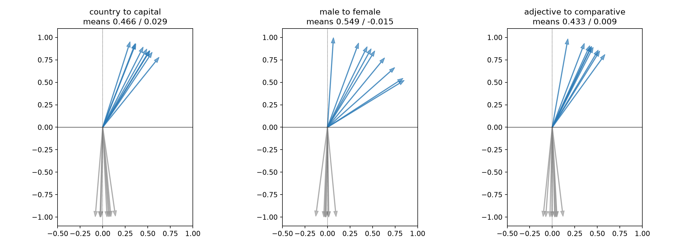

### Part 2: Count models

Command: `uv run python scripts/part2.py`.

| Model | Nats/token | Perplexity | Bits/character |
|---|---:|---:|---:|
| Uniform | 6.238 | 512.00 | 4.386 |
| Unigram | 4.839 | 126.39 | 3.403 |
| Bigram | 3.038 | 20.87 | 2.136 |
| Trigram | 2.094 | 8.12 | 1.473 |
| 4-gram | 1.863 | 6.44 | 1.310 |
| 5-gram | 2.083 | 8.02 | 1.464 |
| 6-gram | 2.550 | 12.81 | 1.793 |

Explicit bigram probability sums for lengths 1, 2, and 3 equal 1. The pooled chi-squared test for 250,000 sampled tokens gives p=0.647, with every pooled expected count at least 5. The unseen fractions for 3–6-grams are 0.63%, 4.15%, 12.22%, 23.50%. The lowest loss is at 4-gram.

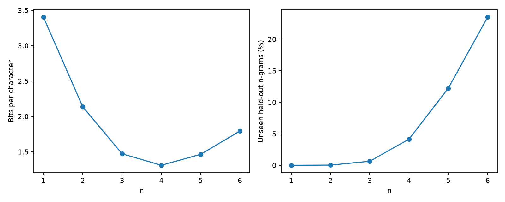

### Part 3: MLP and memory

Commands: `uv run python scripts/part3_mlp.py` and `uv run python scripts/part3_memory.py`. The MLP reaches 3.044 nats/token, approximately 0.006 above the bigram. Identical preceding tokens are aggregated by counts when computing each batch gradient, which is equivalent to averaging the individual sample losses.

At d=64, estimated capacities are approximately 64.1 for outer product, 128.0 for least squares, 2,859.8 for ReLU², and 38,500 for ReLU³. The independent small-case least-squares check has maximum error 7.12×10⁻¹⁴. The fitted slopes are 0.982, 1.000, 0.893, 1.883, and 2.810, respectively. The original ReLU result is below the required 0.900 lower bound; a separate three-draw repeat with seed 4819 gives 1.052. Individual draws are stored in `artifacts/part3_memory_trials.json`.

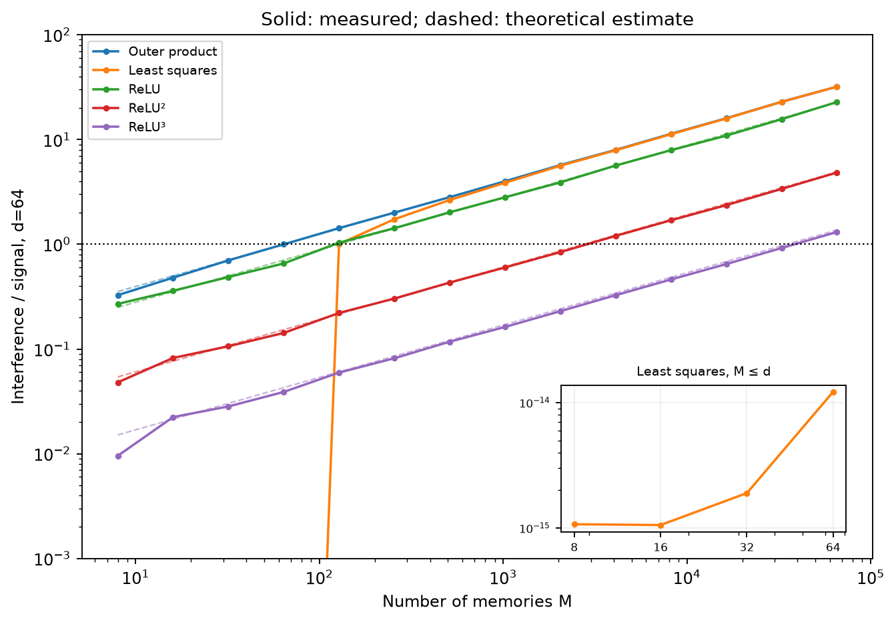

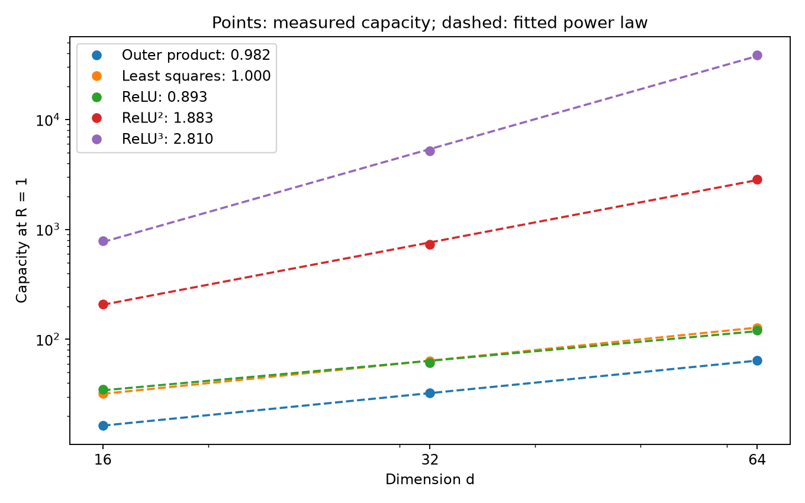

Optional unit analysis: `uv run python scripts/part3_units.py`. The median top-five activation share is 0.182 after training and 0.137 at initialization. The learning-sheet text reports about 0.12 after training, whereas Figure 11 labels it 0.163; this run does not reproduce the direction stated in the text. The top input and output tokens for each signed side are in `artifacts/part3_unit_analysis.json`.

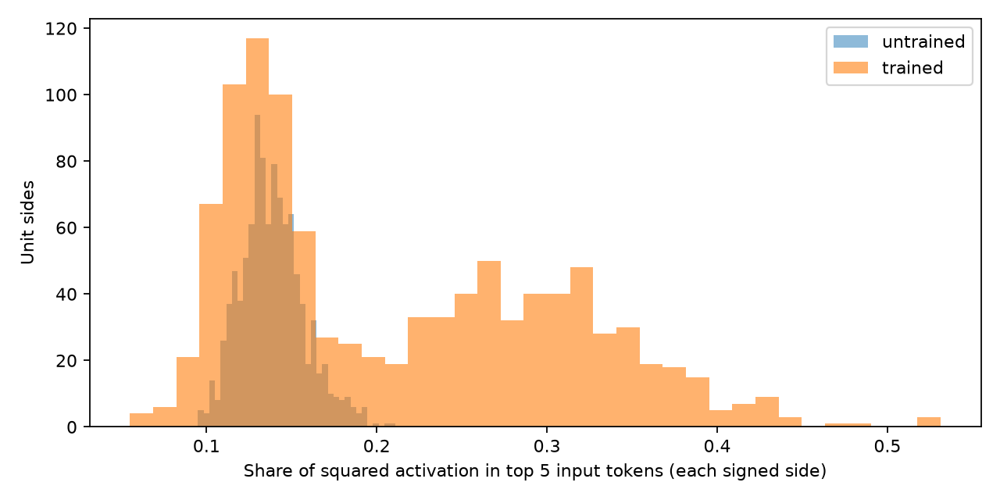

### Part 4: Picture recall

Command: `uv run python scripts/part4.py`. The 32×32 target is the character “算”, represented by +1 for ink and −1 for background. The bitmap in `inputs/suan_32.png` was generated using a Song font and is not the original pixel data from the learning sheet. At M=4,096, the interference-to-signal ratio is 1.214 for ReLU² and 0.058 for softmax; softmax remains below 0.1 for all four memory counts.

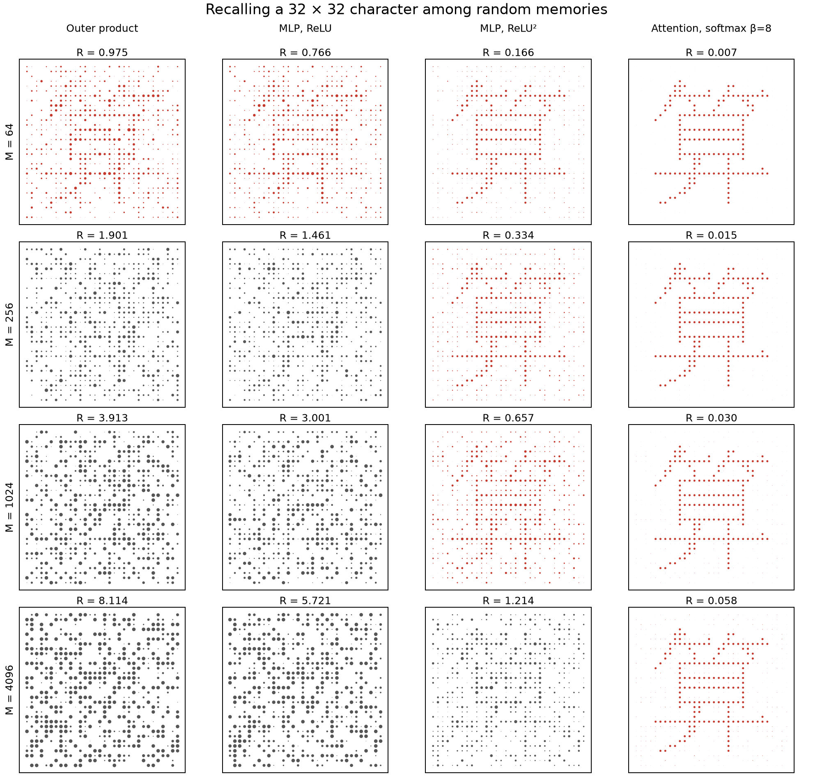

### Part 5: Transformer

Commands: `uv run python scripts/part5_train.py` and `uv run python scripts/part5_evaluate.py`. The model has two layers, width 96, four heads, and context length 64; it was trained for 6,000 AdamW steps with 32 sequences per step, 300 warmup steps, and cosine decay. Its held-out estimate is **1.205 bits/character**, below the 4-gram’s 1.310. For positions with 32–64 tokens read, the maximum loss is 1.663 nats/token, below the trigram’s 2.094.

The actual sampling path is tested against independently constructed target distributions. The chi-squared p-values for temperature, top-k, top-p, and min-p are 0.887, 0.072, 0.950, and 0.197. At temperature 0.0001, all 100,000 draws returned the maximum-probability token in the selected context. The surprise-minus-entropy z-scores are 0.40 at T=1 and −67.19 at T=0.7. The context was selected from 128 validation fragments for high entropy and a top-two logit gap of at least 0.005; the finite-temperature greedy result is therefore context-specific. Token IDs, category counts, and target probabilities are in `artifacts/part5_sampling.json`; the 128-sequence runs and per-sequence statistics are in `artifacts/part5_self_consistency_runs.npz`.

The Transformer’s bpc is an approximation: 1,078,976 target tokens in consecutive 64-token windows were scored, then the mean loss was converted using the full validation character/token ratio. The first token and final 19 tokens were not individually scored. N-gram scores likewise omit the initial positions without full history.

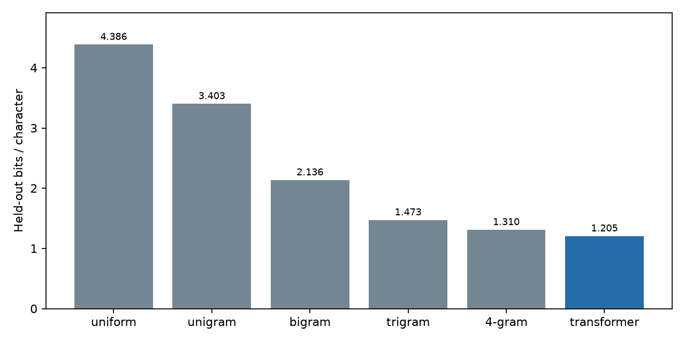

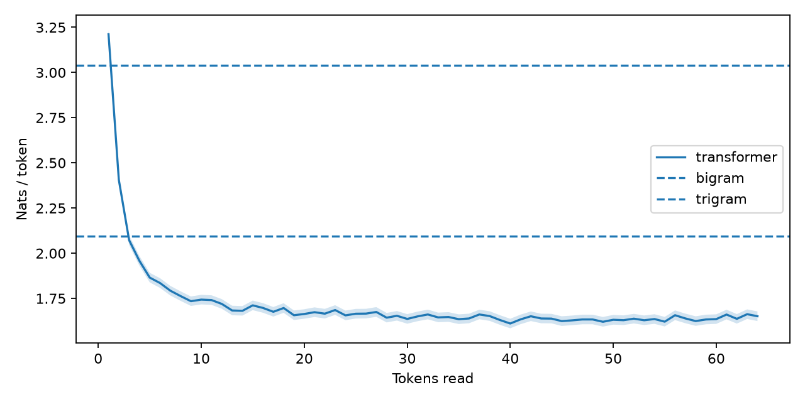

Samples at temperature 1, ordered by bits/character (same seed, 60 tokens each, EOS excluded; JSON escapes mark control characters):

```text
transformer: "Sue and Max Bat are playing in the sky. It likes to look at him, but the octopus did not know what it was. Sam als"
trigram: "Lily liked to do you thin b�5 c\n�06myithMgch�b� bew�ge� Ho> so)�P�� playr��d##Z”\u001d�ntt She made a toy c"
bigram: "Lily, there was very mad she a som we worited with it. Mick. She said. She flealan's the pris plag wat bared. re with elewing unt and anor"
unigram: "spd to. Lilyingilhe aed time a gededae.ur playu ee he Heououked  cAd the epingotey b goundndcc w go hea had withid to ss p"
uniform: "\u001aR for>Ǫ�\u0007\b5 c\n�06myithMgch�b� bew�ge� Ho> so)�P�� playrF�d##Z”\u001d�ntt She mޕ8\u001a namedz"
```

Optional attention-head visualization: `uv run python scripts/part5_attention.py`. The plots show where each head reads; the weights alone do not establish what computation the head performs.

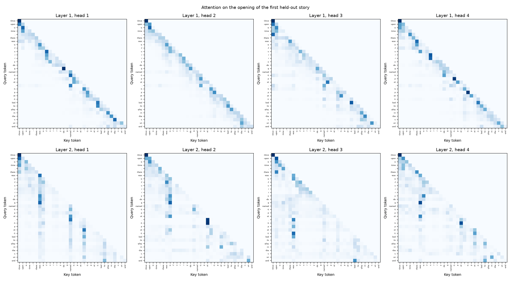

### Part 6: Chinchilla scaling fit

Command: `uv run python scripts/part6.py`. The five highest-loss runs are excluded, leaving 240. A multi-start L-BFGS fit uses Huber loss (δ=0.001) on log loss. Summing the loss and using tighter stopping conditions avoids the premature stopping observed in the earlier mean-loss bootstrap. All 400 bootstrap optimizations reported success.

The fitted values are E=1.8172, α=0.3473, β=0.3672. At the specified Chinchilla budget, the estimated token/parameter ratio is 17.92, with a 95% bootstrap interval of 7.83–37.58. The mean log residuals are -0.00066 for this fit and 0.01674 for the printed parameters. Earlier results are retained in `artifacts/part6_before_audit.json`.

| Parameter | Fit | Bootstrap standard error |
|---|---:|---:|
| E | 1.8172 | 0.025478 |
| A | 477.83 | 123.17 |
| B | 2143.4 | 1110.2 |
| alpha | 0.34731 | 0.014951 |
| beta | 0.36717 | 0.020376 |

| Training compute C (FLOP) | Optimal parameters N* | Optimal training tokens D* |
|---:|---:|---:|
| 1e+18 | 8.02e+07 | 2.078e+09 |
| 1e+19 | 2.619e+08 | 6.365e+09 |
| 1e+20 | 8.55e+08 | 1.949e+10 |
| 1e+21 | 2.792e+09 | 5.97e+10 |
| 1e+22 | 9.115e+09 | 1.828e+11 |
| 1e+23 | 2.976e+10 | 5.6e+11 |
| 1e+24 | 9.718e+10 | 1.715e+12 |
| 1e+25 | 3.173e+11 | 5.253e+12 |

The bootstrap interval captures resampling variability; it does not account for every measurement or model-form uncertainty.

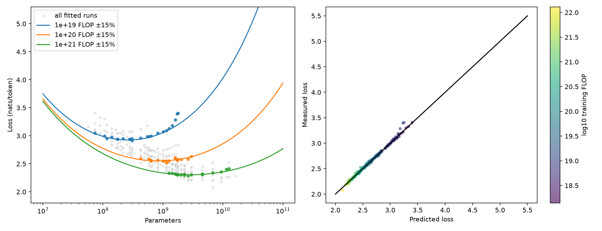

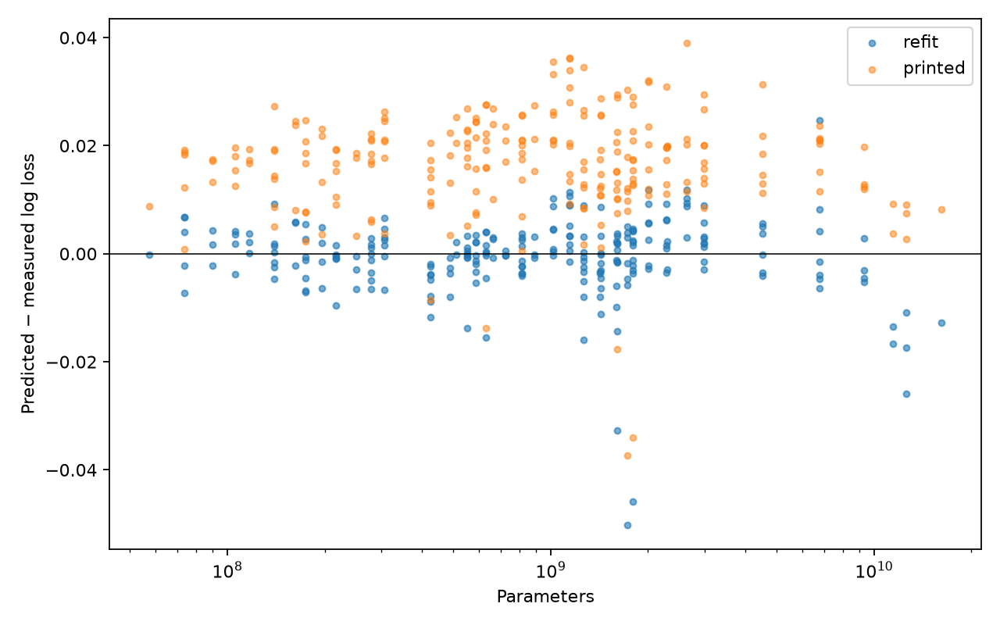

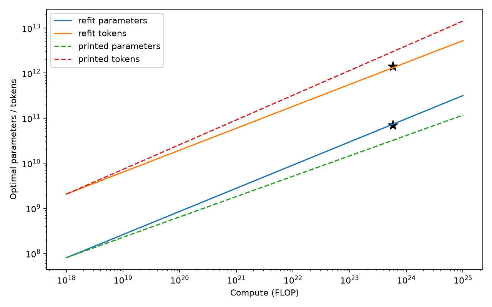

## Presentation and submission

The learning sheet asks students to show their evidence at the start of Week 9 and states that nothing is submitted. The code, English README, and evidence are shared in the repository; downloaded data and raw runs remain local. The two recommended videos have not been watched in full, and the Ubuntu reproduction commands remain untested.
